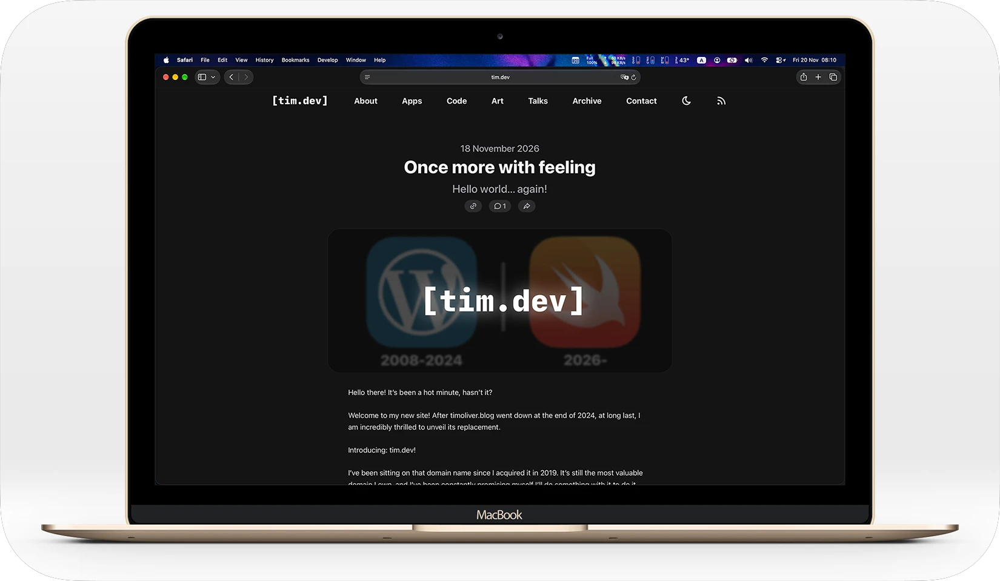

<p align="center">
    <a href="https://github.com/TimOliver/tim.dev/actions/workflows/deploy.yml"></a>
    
    <a href="https://github.com/Ignite-Swift/Ignite"></a>
    <a href="LICENSE"></a>
</p>

[tim.dev] is my personal website, featuring my blog, and a portfolio of my past work. Originally launched in 2008 as a WordPress instance, the site has now been rewritten from the ground up for the modern web.

This site is now statically generated, with the generator itself being an extension of [Ignite](https://github.com/Ignite-Swift/Ignite), a modern static site generator, written in Swift.

## Features

- The blog contains every post back to 2008 cleanly migrated over, but kept at its original WordPress URL.
- Portfolio pages showcasing my app contributions, open-source software, artwork, and meetup presentations.
- All post comments have been migrated over to a self-hosted [Comentario](https://comentario.app) instance.
- Proper responsive design, with discrete modes for desktop, tablet, and smartphone sized screens.
- Selectable light and dark modes, with your choice being persisted in local storage.
- Hosted as static files on Bunny.net, deployed by GitHub Actions on every push.

## System Requirements

macOS with Xcode (Swift 6), and Python 3.11 or above.

## Running Locally

```sh
bash Scripts/setup.sh                      # once: a .venv with Pillow, plus git hooks
bash Scripts/build.sh
python3 Scripts/dev-server.py Build 8000
```

The build generates the responsive images and the site, then verifies every page for broken links and markup.
Once you've run the server command, open [http://localhost:8000](http://localhost:8000) to test the site locally.

When you're done, optionally run `bash Scripts/clean.sh` to put everything back.

## Credits

tim.dev was created by [Tim Oliver](https://tim.dev).

The site also takes advantage of a number of excellent third party library and artwork packages. Please see the [Acknowledgements](https://tim.dev/acknowledgements/) page for the complete list.

## AI Usage Disclosure

While I designed and built the foundation of this site myself, I also used agentic assistance to help me complete it.

This included using Claude Code and OpenAI's Codex to write much of the HTML, CSS, JavaScript, Swift and Python, and having both agents adversarially review each other's code. This let me finish the site orders of magnitude faster, and at a higher level of quality than I could have done by hand.

I also occasionally had the agents write placeholder text, and suggest edits while I wrote the final copy. Ultimately, every word on this site was chosen by me.

When designing this site, I used Claude Design to generate various prototypes of each page, so I could experiment with the placement and alignment of UI elements. I would then rework those prototypes into the site's design system.

Commits that were made by an agent have been marked with a 'Co-Authored-By' trailer. This is enforced at the AGENTS.md level.

## License
The code is public domain under the Unlicense. The writing and images are all rights reserved. 

Bundled third-party files keep their own licences. Please see the [LICENSE](LICENSE) and [THIRD-PARTY-NOTICES](THIRD-PARTY-NOTICES) files.
